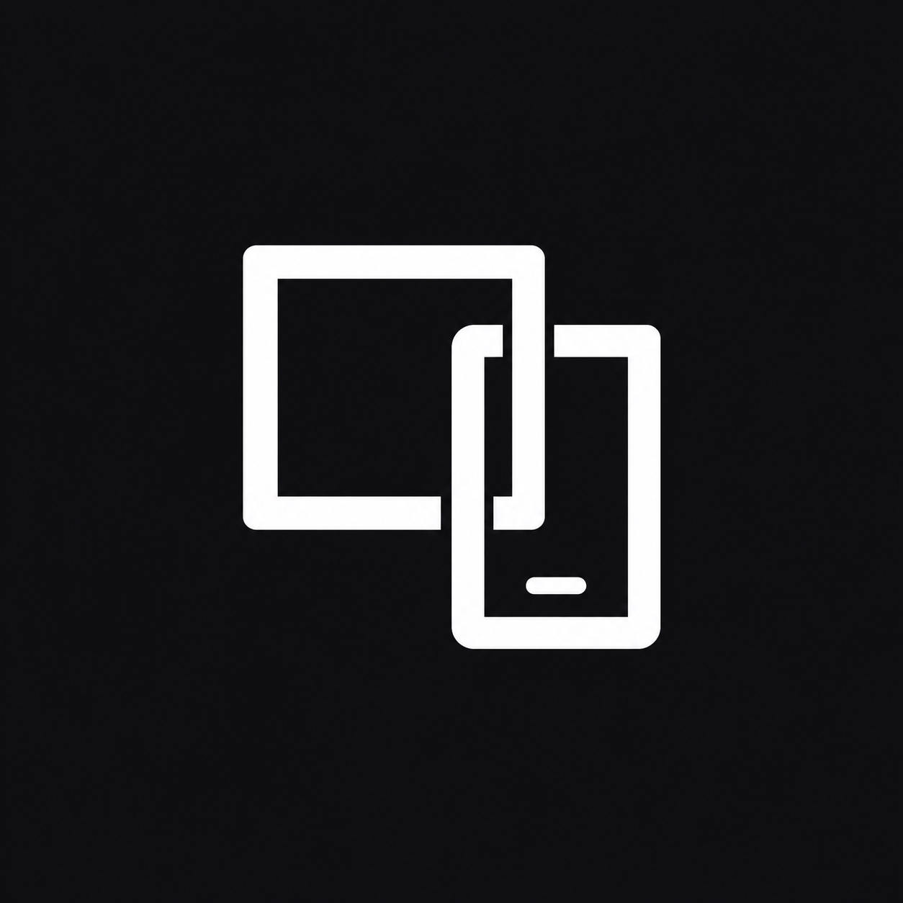
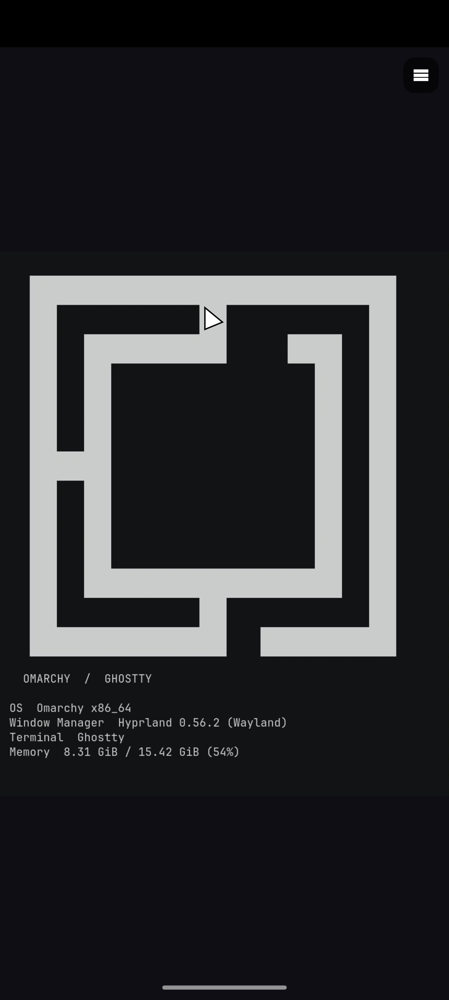
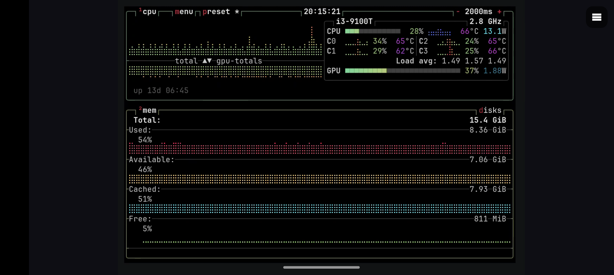

# OmaViewer

Control your Omarchy computer from an Android phone.

- View one window or a full monitor.
- Click, drag, scroll, zoom, and use desktop keys.
- Open multiple terminals that stay active after disconnection.
- Transfer files and folders with your computer account's permissions.
- Copy text and images between devices while the app is on the screen.
- Save computer connections and change themes, text size, and controls.

Requires Omarchy and Android 8 or later. The default connection method uses Tailscale.

[Setup](docs/setup.md) | [Build instructions](docs/build-portability.md) | [Settings](host/README.md) | [Known issues](docs/phone-test.md)

  

OmaViewer uses the [MIT license](LICENSE). Included projects keep their own [licenses](THIRD_PARTY_NOTICES.md).
