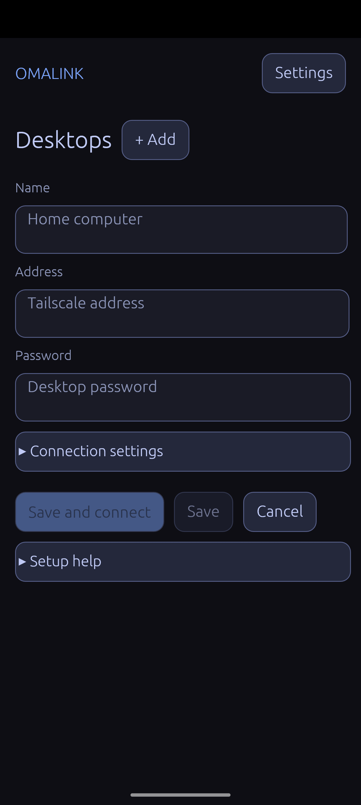
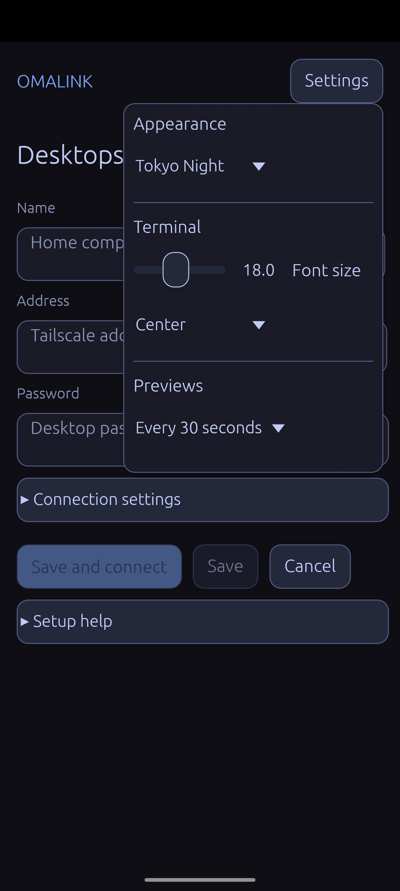

# OmaLink

OmaLink lets you control your Omarchy computer from an Android phone.

View one window or a full monitor. Use the phone to enter text, run terminal commands, and transfer files.

## Requirements

- An Omarchy computer with an active Hyprland session
- An Android phone with Android 8 or later
- Tailscale on both devices for the default connection method

Tests used an ARM64 phone. Other phone architectures need more tests.

<p>
  
  
</p>

## Functions

- Select a window from its preview image.
- View a full monitor.
- Click, right-click, drag, and scroll with touch controls.
- Zoom in and move the view.
- Use Super, Ctrl, Alt, Shift, arrows, Tab, Esc, and F1 to F12.
- Open multiple terminal sessions. Sessions stay open when the phone disconnects.
- Transfer files and folders. Computer file permissions still apply.
- Copy text and images between the two clipboards while the app is on the screen.
- Save connections to multiple computers.
- Change the theme, text size, control position, and preview interval.

To right-click, tap once. Then touch and hold the same point.

## Install the computer software

Use Rust 1.95 or later.

1. Install the required tools and libraries:

   ```sh
   sudo pacman -S --needed base-devel clang cmake nasm pkgconf libva pipewire \
     libxkbcommon wayland mesa pam tmux wl-clipboard
   ```

2. Open a terminal in the project directory.
3. Build the screen capture software:

   ```sh
   cargo build --release --locked --manifest-path tools/hypr-rdp/Cargo.toml
   ```

4. Build and install the host:

   ```sh
   ./tools/install-host.sh --build --prefix "$HOME/.local"
   ```

5. Add the installation directory to the command search path:

   ```sh
   export PATH="$HOME/.local/bin:$PATH"
   ```

6. Check the host:

   ```sh
   windowlink-host check
   ```

The host is the program that runs on your computer. Run it from your Hyprland session with your normal user account.

This repository includes the modified Hypr-RDP source. It does not need a separate Git submodule.

## Connect the phone

1. Build the Android APK. See the [build instructions](docs/build-portability.md).
2. Install `android/app/build/outputs/apk/debug/app-debug.apk` on the phone.
3. Connect both devices to the same Tailscale network.
4. Start the host:

   ```sh
   windowlink-host serve --tailscale
   ```

5. Read the address, username, password, and control port from the host output.
6. Enter these values in OmaLink on the phone.

Keep the host output private. It contains the connection password.

The APK uses a debug signing key.

## Settings

Use **Settings** on the phone to change its display, terminal, clipboard, and file transfer settings.

Host settings use `~/.config/omalink/host.json` by default. If `XDG_CONFIG_HOME` is set, they use `$XDG_CONFIG_HOME/omalink/host.json`.

Copy the [example file](host/config.example.json) to this location. Change the values as necessary. Command-line options take priority over file settings.

See the [host reference](host/README.md) for all options.

The control API uses HTTP and a bearer token. Tailscale encrypts this connection. Use other connection methods only on trusted networks. Do not expose the control port to the internet.

## Tests

Run these commands from the project directory:

```sh
cargo test --locked --manifest-path shared/Cargo.toml
cargo test --locked --manifest-path host/Cargo.toml
cargo test --locked --manifest-path android/Cargo.toml --lib
```

The CI configuration also tests and builds the modified Hypr-RDP software. See the [test report](docs/phone-test.md) for results.

## Known problems and limits

- Some dialog windows need separate selection. Full monitor view is another option.
- Image clipboard transfers and Android Share need more phone tests.
- Recovery after an interrupted file transfer needs more phone tests.
- Rotation during app startup can close the app. If this occurs, force-stop the app. Then open it again.
- Android clipboard limits are 1 MiB for text and 32 MiB for images.
- Host executables need compatible system libraries. Build them on the destination computer if necessary.

## License

OmaLink code uses the MIT license. Included projects keep their own licenses. See [third-party notices](THIRD_PARTY_NOTICES.md).
